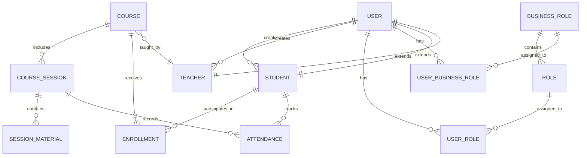
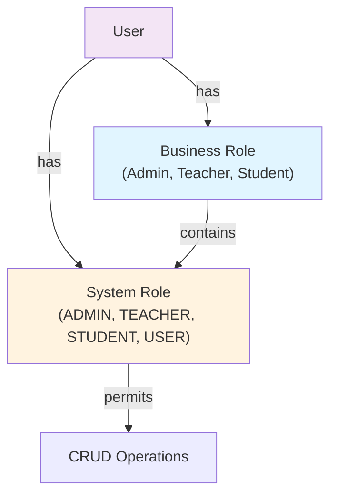

# English Center System - Core Specification Document

**Version:** 1.0  
**Last Updated:** June 12, 2026  
**Author:** System Analysis  
**Status:** Active Development

---

## Table of Contents

1. [Executive Summary](#executive-summary)
2. [System Overview](#system-overview)
3. [Domain Model](#domain-model)
4. [Business Rules & Constraints](#business-rules--constraints)
5. [Glossary](#glossary)
6. [System Assumptions](#system-assumptions)

---

## Executive Summary

The **English Center System** is a comprehensive educational management platform designed to streamline course management, student enrollment, teacher administration, and attendance tracking for an English language learning center.

**Key Capabilities:**
- Centralized user management with role-based access control (RBAC)
- Course lifecycle management (creation, enrollment, scheduling, completion)
- Student enrollment with eligibility verification
- Attendance tracking and session material management
- Teacher and student profile management
- Role hierarchy: Admin → Business Role (Admin/Teacher/Student) → System Role

**Architecture:** Full-stack monorepo with Spring Boot 3.5.7 backend (Java 24) and React 19 frontend (TypeScript)

---

## System Overview

### Purpose

The English Center System provides:
1. **Course Administration** - Create, schedule, and manage English language courses
2. **Student Management** - Register students, track enrollment, verify eligibility
3. **Teacher Management** - Manage teacher profiles and course assignments
4. **Attendance Tracking** - Record student attendance per session
5. **Learning Materials** - Attach course materials to sessions
6. **Access Control** - Role-based permissions and user management

### Scope

**In Scope:**
- User authentication (JWT-based)
- Course and session management
- Student enrollment with eligibility rules
- Attendance tracking
- Basic reporting (course lists, student lists, attendance records)
- Admin panel for system administration

**Out of Scope (Phase 2+):**
- Payment/billing system
- Advanced analytics and reporting
- Mobile app
- Video hosting
- Integration with third-party LMS
- Real-time notifications

### Key Stakeholders

| Role | Responsibilities |
|------|------------------|
| **Admin** | System administration, user management, role assignments, course oversight |
| **Teacher** | Course creation, session scheduling, attendance marking, material upload |
| **Student** | Course enrollment, attendance, material access |
| **Center Manager** | Reporting, analytics, staff management |

### Technology Stack

**Backend:**
- Spring Boot 3.5.7 with Java 24
- Spring Data JPA + Hibernate
- MySQL 8.0+ database
- JWT authentication (jjwt library)
- Spring Security for authorization
- SpringDoc OpenAPI for API documentation

**Frontend:**
- React 19 with React Router 7
- TypeScript strict mode
- Redux Toolkit for state management
- React Hook Form + Zod for validation
- TailwindCSS for styling
- Axios for HTTP client

**Infrastructure:**
- Windows 11 / Git Bash / PowerShell development environment
- MySQL database
- No containerization yet (planned for Phase 2)

---

## Domain Model

### Entity Relationship Diagram



### Core Entity Descriptions

#### User Entity
**Purpose:** Central authentication and profile management for all system users.

| Field | Type | Constraints | Business Rule |
|-------|------|-----------|---------------|
| id | Long | PK, Auto-generated | Unique identifier |
| username | String(50) | Unique, Not null | Immutable login identifier |
| password | String(255) | Not null | Bcrypt hashed (handled by auth service) |
| email | String(100) | Unique | Contact identifier |
| fullName | String(100) | | Display name |
| phone | String(20) | | Contact number |
| status | Enum (ACTIVE, INACTIVE, SUSPENDED) | | Active users can access system |
| createdAt | DateTime | Auto-set | Audit trail |
| updatedAt | DateTime | Auto-update | Audit trail |

**Relationships:**
- One-to-Many: User → UserRole (many system roles)
- One-to-Many: User → UserBusinessRole (one primary business role, may have history)
- One-to-One: User → Student (optional, if user is a student)
- One-to-One: User → Teacher (optional, if user is a teacher)

---

#### Student Entity
**Purpose:** Extends User to capture student-specific attributes and eligibility tracking.

| Field | Type | Constraints | Business Rule |
|-------|------|-----------|---------------|
| id | Long | PK | |
| user_id | FK(User) | Not null, Unique | One user = one student profile |
| dateOfBirth | Date | | Used for minimum age eligibility check |
| gender | Enum (MALE, FEMALE, OTHER) | | Demographic data |
| address | String(255) | | Contact address |
| parentName | String(50) | | Emergency contact |
| parentPhone | String(10) | | Emergency contact |
| entryLevel | Enum (BEGINNER, ELEMENTARY, INTERMEDIATE, ADVANCED) | | Current English proficiency |
| prerequisitesCompleted | Boolean | Default: false | Tracks prerequisite course completion |

**Business Rules:**
- Student can enroll in courses only if age >= course.minimumAge
- Student entry level must match course.requiredEntryLevel
- If course.prerequisitesRequired = true, student.prerequisitesCompleted must = true
- One user account maps to exactly one student profile

---

#### Teacher Entity
**Purpose:** Extends User to track teacher-specific attributes (compensation, expertise).

| Field | Type | Constraints | Business Rule |
|-------|------|-----------|---------------|
| id | Long | PK | |
| user_id | FK(User) | Not null, Unique | One user = one teacher profile |
| salary | Decimal(12,2) | | Compensation tracking |

**Relationships:**
- One-to-Many: Teacher → Course (one teacher teaches many courses)
- The availableRoleTeacher field on Course controls which teacher roles can teach

---

#### Course Entity
**Purpose:** Central course definition with scheduling, enrollment limits, and eligibility rules.

| Field | Type | Constraints | Business Rule |
|-------|------|-----------|---------------|
| id | Long | PK | |
| code | String(30) | Unique, Not null | Immutable course identifier (e.g., "ENG101") |
| name | String(100) | Not null | Course title |
| startDate | Date | Not null | When course begins |
| endDate | Date | Not null | When course ends |
| maxStudent | Integer | | Enrollment capacity |
| status | Enum (PLANNING, ACTIVE, COMPLETED, CANCELLED) | Default: PLANNING | Lifecycle state |
| minimumAge | Integer | | Minimum student age for enrollment |
| requiredEntryLevel | String(30) | | Prerequisite student entry level |
| prerequisitesRequired | Boolean | Default: false | Must have completed prior courses |
| teacher_id | FK(Teacher) | | Assigned instructor (one-to-many from teacher side) |
| availableRoleTeacher | Enum(Roles) | | Which system roles can teach this (TEACHER, ADMIN, etc.) |

**Business Rules:**
- Course code is immutable (used for external reference)
- Status progression: PLANNING → ACTIVE → COMPLETED
- startDate < endDate (validated)
- maxStudent > 0 if specified
- One teacher assigned per course
- Enrollment capacity enforced during student enrollment

---

#### CourseSession Entity
**Purpose:** Individual session/class instance within a course (one course may have many sessions).

| Field | Type | Constraints | Business Rule |
|-------|------|-----------|---------------|
| id | Long | PK | |
| course_id | FK(Course) | Not null | Parent course |
| sessionNo | Integer | | Sequential session number within course |
| title | String(255) | | Session topic or title |
| sessionDate | Date | Not null | Date of the session |
| startTime | Time | Not null | Class start time |
| endTime | Time | Not null | Class end time |
| topic | String(255) | | Topic covered in this session |

**Business Rules:**
- sessionNo is unique within a course (1-based indexing)
- startTime < endTime (validated)
- sessionDate should be between course.startDate and course.endDate
- Teacher for this session is inherited from course.teacher

---

#### Enrollment Entity
**Purpose:** Tracks student participation in a course with eligibility verification.

| Field | Type | Constraints | Business Rule |
|-------|------|-----------|---------------|
| id | Long | PK | |
| student_id | FK(Student) | Not null | Enrolled student |
| course_id | FK(Course) | Not null | Target course |
| enrollDate | Date | Not null | When student enrolled |
| status | String(20) | Default: "PENDING" | PENDING, APPROVED, REJECTED, COMPLETED, WITHDRAWN |
| ageEligible | Boolean | Not null | Did student pass age check? |
| entryLevelEligible | Boolean | Not null | Did student pass entry level check? |
| prerequisitesEligible | Boolean | Not null | Did student pass prerequisites check? |
| eligibilityCheckDate | DateTime | Not null | When eligibility was last verified |

**Business Rules:**
- Composite unique constraint: (student_id, course_id) - one enrollment per student per course
- Eligibility checks automated during enrollment:
  - ageEligible = (student.dateOfBirth + course.minimumAge) <= today
  - entryLevelEligible = (student.entryLevel == course.requiredEntryLevel)
  - prerequisitesEligible = (!course.prerequisitesRequired OR student.prerequisitesCompleted)
- Enrollment moves to APPROVED if all eligibility flags true, else PENDING for admin review
- Withdrawal allowed from PENDING/APPROVED states

---

#### Attendance Entity
**Purpose:** Tracks student presence/absence for accountability and reporting.

| Field | Type | Constraints | Business Rule |
|-------|------|-----------|---------------|
| id | Long | PK | |
| session_id | FK(CourseSession) | Not null | Which session |
| student_id | FK(Student) | Not null | Which student |
| status | String(20) | Not null | PRESENT, ABSENT, EXCUSED, LATE |
| note | String(255) | | Reason for absence/excuse |

**Business Rules:**
- Composite unique: (session_id, student_id) - one record per student per session
- Only enrolled students can have attendance records
- Status set by teacher during/after session
- EXCUSED status must have a note
- Attendance used for course completion eligibility (e.g., 80% minimum attendance)

---

#### SessionMaterial Entity
**Purpose:** Stores course learning materials (handouts, slides, recordings, links).

| Field | Type | Constraints | Business Rule |
|-------|------|-----------|---------------|
| id | Long | PK | |
| session_id | FK(CourseSession) | Not null | Which session |
| fileName | String(255) | | Original file name |
| fileUrl | String(500) | | URL/path to file (S3, disk, etc.) |
| fileType | String(50) | | MIME type or category (PDF, VIDEO, LINK, etc.) |
| uploadedBy | Long | | User ID who uploaded |

**Business Rules:**
- Materials uploaded by session teacher or admin
- Students can view materials for their enrolled courses
- One file can be material for multiple sessions (ideally referenced, not duplicated)

---

### Role & Access Control Model



#### Role Hierarchy

**Business Roles** (Center-level categories):
1. **ADMIN** - Full system access, user management, all configuration
2. **TEACHER** - Course creation, session management, attendance, materials
3. **STUDENT** - Course enrollment, material access, attendance viewing
4. **STAFF** - Support role (audit, reporting, no data modification)

**System Roles** (Feature-level permissions):
1. **ADMIN** - All operations
2. **TEACHER** - Course CRUD, session CRUD, attendance write, materials upload
3. **STUDENT** - Enrollment read/write, course view, materials read, own attendance read
4. **USER** - Profile update, own course viewing
5. **GUEST** - Public content only (login page, public info) - not fully in system

**Mapping:** 
- User has one primary BusinessRole (via UserBusinessRole)
- User has one or more SystemRoles (via UserRole)
- BusinessRole → SystemRole mapping: ADMIN→[ADMIN], TEACHER→[TEACHER], STUDENT→[STUDENT,USER]

---

## Business Rules & Constraints

### Enrollment Rules

**Rule 1: Eligibility Verification**
- When student attempts enrollment, system automatically checks:
  1. Age requirement: `student.dateOfBirth + course.minimumAge <= today`
  2. Entry level match: `student.entryLevel == course.requiredEntryLevel`
  3. Prerequisites: If `course.prerequisitesRequired = true`, student must have `prerequisitesCompleted = true`
- If all conditions met → enrollment status = APPROVED
- If any fail → enrollment status = PENDING (admin review required)

**Rule 2: Single Enrollment per Course**
- A student cannot enroll in the same course twice (composite unique constraint)
- If withdrawal is needed, admin must explicitly withdraw before new enrollment

**Rule 3: Course Capacity**
- If `course.maxStudent` is set, enroll up to that limit
- Once limit reached, new enrollments go to PENDING (waitlist) regardless of eligibility

**Rule 4: Enrollment Status Lifecycle**
```
PENDING → APPROVED → COMPLETED
        → REJECTED
```
- PENDING: Awaiting eligibility or capacity review
- APPROVED: Student enrolled and attending
- COMPLETED: Course ended, student participated
- REJECTED: Did not meet eligibility, student cannot take course

---

### Attendance Rules

**Rule 1: Attendance Recording Window**
- Attendance can only be recorded for sessions that have occurred
- Records can be edited up to 7 days after session date (configurable)

**Rule 2: Course Completion Eligibility**
- Student must have >= 80% attendance (configurable per course) to complete course
- Calculated as: `PRESENT sessions / Total sessions`
- EXCUSED does NOT count as PRESENT

**Rule 3: Attendance Status Meanings**
| Status | Definition | Impact |
|--------|-----------|--------|
| PRESENT | Student attended the full session | Counts toward attendance % |
| ABSENT | Student did not attend | Does NOT count toward attendance % |
| EXCUSED | Student absent but with valid reason | Does NOT count toward attendance %, noted in system |
| LATE | Student attended but arrived after start time | Counts as PRESENT |

---

### Course Lifecycle Rules

**Rule 1: Status Progression**
- PLANNING → ACTIVE (manually triggered)
- ACTIVE → COMPLETED (auto when endDate reached, or manual)
- Any status → CANCELLED (emergency cancellation)
- Cannot revert to previous status

**Rule 2: Enrollment Only in ACTIVE Courses**
- Students can only enroll in ACTIVE courses
- Cannot enroll in PLANNING (not yet open), COMPLETED (closed), CANCELLED (not valid)

**Rule 3: Session Constraints**
- All sessions must fall between course.startDate and course.endDate
- Cannot add sessions after course status = COMPLETED

---

### Teacher Assignment Rules

**Rule 1: Course-Teacher Link**
- Each course has exactly one teacher assigned
- Teacher can teach multiple courses
- Teacher reassignment possible before course starts, requires admin approval

**Rule 2: Role-Based Teaching**
- Course.availableRoleTeacher defines which role types can teach
- Usually TEACHER, but could include ADMIN for coverage

---

### Material Management Rules

**Rule 1: Visibility**
- Only students enrolled in the course can access materials
- Teachers can access all course materials they teach
- Admin can access all materials

**Rule 2: Upload Authorization**
- Only session teacher or admin can upload materials
- File size limit: 50MB per file (configurable)
- Supported formats: PDF, DOCX, PPTX, images, video (configurable)

---

### User Management Rules

**Rule 1: Unique Constraints**
- username must be unique across all users
- email must be unique across all users
- One user can have at most one Student profile and one Teacher profile

**Rule 2: Status Transitions**
- ACTIVE ↔ INACTIVE (admin toggle)
- ACTIVE → SUSPENDED (admin, requires reason)
- SUSPENDED → ACTIVE (admin)

**Rule 3: Deletion Policy**
- Users are never hard-deleted (audit trail)
- Deletion is status change to INACTIVE

---

### Data Integrity Rules

**Rule 1: Cascade Rules**
- Delete course → Keep enrollments (mark as WITHDRAWN)
- Delete student → Keep enrollment records (audit)
- Delete teacher → Unassign from courses, alert admin

**Rule 2: Temporal Consistency**
- startDate < endDate (enforced in validation)
- sessionDate between course.startDate and course.endDate
- eligibilityCheckDate ≤ now

---

## Glossary

| Term | Definition | Example |
|------|-----------|---------|
| **Enrollment** | Record of student participation in a course, with eligibility status | Student ID 5 enrolled in Course ENG101 on 2026-06-01 |
| **Session** | Individual class meeting instance within a course | ENG101 Session 3 on 2026-06-15 from 18:00-19:30 |
| **Business Role** | High-level organizational role (Admin, Teacher, Student) | "ADMIN" user manages system config |
| **System Role** | Granular permission level tied to features | "TEACHER" role can create courses |
| **Eligibility** | Student meets prerequisites to enroll in a course | Age >= min, Entry Level = required, Prerequisites done |
| **Prerequisite** | Prior course completion required before enrolling in current course | Must complete ENG101 before ENG102 |
| **Entry Level** | Student's current English proficiency (BEGINNER, ELEMENTARY, INTERMEDIATE, ADVANCED) | New student at BEGINNER level |
| **Attendance** | Record of student presence/absence at a session | Student marked PRESENT at 2026-06-15 session |
| **Material** | Learning resource (document, video, link) attached to a session | Slide deck for grammar lesson |
| **Composite Unique Key** | Multiple fields together must be unique | (student_id, course_id) in enrollments |
| **Audit Fields** | Automatic tracking of creation and modification | createdAt, updatedAt on all entities |

---

## System Assumptions

### Data Assumptions

1. **User Email is Valid**
   - System does NOT validate email format beyond basic String type
   - Assumption: Admin validates real email before creating users
   - Verification by email confirmation: NOT implemented (Phase 2)

2. **Phone Numbers are Text**
   - Phone numbers stored as String, not strictly validated
   - No international format enforcement
   - Format: Center decides (10-digit, +84, etc.)

3. **Dates Use Server Timezone**
   - All date/time operations use `Asia/Ho_Chi_Minh` (configurable in application.yml)
   - Client sends dates in ISO format; server converts to local timezone
   - No daylight saving time complexity (Vietnam doesn't observe DST)

4. **One User = One Profile**
   - A user account cannot simultaneously be a Student AND Teacher
   - Must create separate users for dual roles

### Business Assumptions

1. **Courses Have One Teacher**
   - Assumption: Each course has exactly one teacher
   - No co-teaching model (Phase 2 enhancement)
   - If teacher unavailable, reassign course to another teacher

2. **Entry Levels are Static**
   - Student entry level does NOT auto-advance after completing a course
   - Admin must manually update student.entryLevel
   - Consider automation in Phase 2

3. **Prerequisite Model is Simple**
   - "Prerequisites required: Y/N" is a binary flag
   - Does NOT track WHICH specific courses are prerequisites
   - Assumption: All prereqs = "previous level course" (e.g., BEGINNER before ELEMENTARY)

4. **Attendance is Manual**
   - No automated attendance (e.g., via biometric, mobile check-in)
   - Teacher manually marks attendance post-session
   - No real-time absence notifications

5. **No Grades/Scoring**
   - System tracks enrollment and attendance ONLY
   - Does NOT track homework, exams, grades (Phase 2)
   - Course completion is based on attendance + enrollment approval

6. **Course Schedule is Fixed**
   - Sessions are manually created/edited
   - No automatic recurring session generation (e.g., "every Tuesday")
   - Phase 2: Recurring schedule engine

### Technical Assumptions

1. **MySQL is Always Available**
   - No offline mode or local data caching
   - Frontend always requires backend connectivity
   - Assumption: Reliable network in deployment environment

2. **JWT Tokens Do Not Refresh**
   - Token lifetime: default 1 hour (configurable)
   - No refresh token mechanism
   - Upon expiration, user must re-login
   - Phase 2: Implement refresh token flow

3. **Single Deployment Instance**
   - No load balancing or horizontal scaling assumed
   - Session storage: JWT only (no server-side session store)
   - Suitable for center <500 concurrent users

4. **File Storage is Local Disk**
   - SessionMaterial.fileUrl points to local file system
   - No S3, CDN, or cloud storage (Phase 2)
   - Backups handled by deployment infrastructure

5. **TypeScript Strict Mode**
   - All frontend code must be type-safe
   - No `any` types allowed
   - Compile-time type checking before runtime

### Operational Assumptions

1. **Admin Availability**
   - System requires active admin for user creation, role assignment, approvals
   - No self-service user signup (can be added in Phase 2)

2. **Course Planning Timeline**
   - Courses created at least 2 weeks before start date
   - Enrollments approved within 48 hours
   - Data entry quality: admin responsible

3. **Backup & Disaster Recovery**
   - Backup strategy: NOT defined in system (deployment concern)
   - Assumption: Deployment environment includes backup procedures

---

## Key Validations

### Input Validation (API Boundary)

All request DTOs validated using annotations:
- `@NotNull`, `@NotBlank` for required fields
- `@Size`, `@Length` for string lengths
- `@Positive`, `@PositiveOrZero` for numeric constraints
- `@Email` for email addresses
- Custom validators for complex rules (e.g., date ranges)

### Business Rule Validation (Service Layer)

- Eligibility checks during enrollment
- Course capacity checks
- Status transition rules
- Temporal constraints (dates)
- Unique constraint validation before insert

---

## Security Assumptions

1. **JWT Signing**
   - JWT_SECRET >= 32 characters (HS256 requirement)
   - Secret stored in environment variables, NOT in code
   - Tokens signed server-side, verified before processing requests

2. **Password Storage**
   - Passwords hashed using Spring Security (bcrypt, default)
   - Never transmitted in plain text
   - HTTPS enforced in production (Phase 2)

3. **Role-Based Authorization**
   - Each endpoint checks user roles before processing
   - @PreAuthorize annotations on all protected methods
   - Admin-only operations require ADMIN role

4. **No Cross-Site Scripting (XSS)**
   - React automatically escapes output by default
   - User-generated content (e.g., notes) treated as text, not HTML

5. **SQL Injection Prevention**
   - JPA @Query with parameters prevents SQL injection
   - All queries use parameterized statements

---

**End of Core Specification Document**
