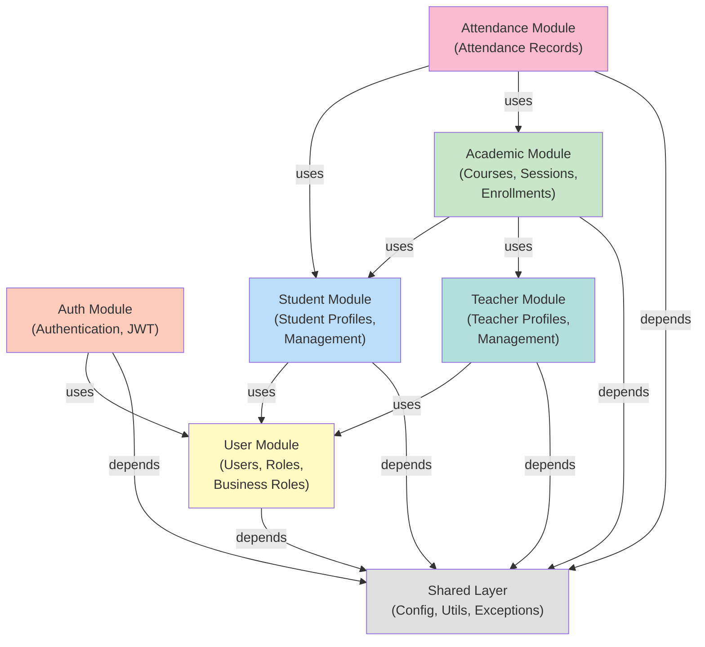

# English Center System - Planning Document

**Version:** 1.0  
**Last Updated:** June 12, 2026  
**Status:** Active Development - Phase 1

---

## Table of Contents

1. [Module Overview](#module-overview)
2. [Feature Roadmap](#feature-roadmap)
3. [Development Phases](#development-phases)
4. [Scope & Constraints](#scope--constraints)
5. [Risk Assessment](#risk-assessment)
6. [Technical Decisions](#technical-decisions)
7. [Success Metrics](#success-metrics)

---

## Module Overview

### Backend Modules Architecture



### Module Specifications

#### 1. **Shared Module** (Utilities & Infrastructure)
**Responsibility:** Cross-cutting concerns, no business logic

**Components:**
- `config/` - Spring configuration (Security, Swagger, JPA, CORS)
- `exception/` - Custom exceptions and GlobalExceptionHandler
- `response/` - StandardResponse wrapper, error response DTOs
- `util/` - Utility functions (date formatting, encryption, etc.)
- `enums/` - Shared enumerations (UserStatus, CourseStatus, EntryLevel, etc.)
- `entity/` - BaseEntity abstract class (audit fields: id, createdAt, updatedAt)

**Maturity:** ✅ Complete (Foundation stable)

---

#### 2. **Auth Module** (Authentication & Authorization)
**Responsibility:** User login, JWT token generation, token validation

**Components:**
- `controller/AuthController` - Login, signup, logout, refresh endpoints
- `service/AuthService` - Login logic, password validation, token generation
- `dto/` - LoginRequest, LoginResponse, SignupRequest, SignupResponse
- `mapper/` - (if needed)

**Key Entities Used:**
- User (from user module)
- Role (from user module)
- UserRole (from user module)

**Endpoints (Current):**
- `POST /auth/login` - Authenticate user, return JWT
- `POST /auth/signup` - Create new user account
- `POST /auth/logout` - Invalidate token (client-side mainly)
- `GET /auth/validate` - Check if token valid (frontend use)

**Maturity:** ⚠️ Partial (Basic login works, refresh tokens not implemented)

**TODO (Phase 1):**
- [ ] Implement refresh token mechanism
- [ ] Add password reset flow
- [ ] Email verification for signup

---

#### 3. **User Module** (User & Role Management)
**Responsibility:** User CRUD, role assignments, business role assignments

**Components:**
- `controller/UserController` - User CRUD, list, update status
- `controller/RoleController` - Role management
- `controller/BusinessRoleController` - Business role management
- `service/UserService` - User creation, updates, status changes
- `service/RoleService` - Role CRUD
- `service/BusinessRoleService` - Business role CRUD
- `repository/` - UserRepository, RoleRepository, BusinessRoleRepository, UserRoleRepository, UserBusinessRoleRepository
- `entity/` - User, Role, BusinessRole, UserRole, UserBusinessRole
- `dto/` - CreateUserRequest, UpdateUserRequest, UserResponse, RoleResponse, BusinessRoleResponse
- `mapper/` - UserMapper, RoleMapper

**Key Entities:**
- User (base user record)
- Role (system role: ADMIN, TEACHER, STUDENT, USER)
- BusinessRole (organizational role: ADMIN, TEACHER, STUDENT, STAFF)
- UserRole (junction table for User → Role M2M)
- UserBusinessRole (junction table for User → BusinessRole)

**Endpoints (Current):**
- `GET /users` - List all users (admin only)
- `GET /users/{id}` - Get user details
- `POST /users` - Create new user (admin only)
- `PUT /users/{id}` - Update user
- `PUT /users/{id}/status` - Change user status
- `GET /roles` - List all system roles
- `POST /roles` - Create role
- `GET /business-roles` - List business roles
- `POST /business-roles` - Create business role
- `POST /users/{id}/roles` - Assign role to user
- `DELETE /users/{id}/roles/{roleId}` - Remove role from user

**Maturity:** ✅ Complete for MVP (CRUD functional, Redux integrated on frontend)

**TODO (Phase 1.5):**
- [ ] Add permission granularity (feature-level permissions)
- [ ] Audit trail for role changes
- [ ] Role inheritance model (if needed)

---

#### 4. **Academic Module** (Courses, Sessions, Enrollments)
**Responsibility:** Course management, session scheduling, student enrollment with eligibility

**Components:**
- `controller/CourseController` - Course CRUD, list, status changes
- `controller/SessionController` - Session CRUD, list by course
- `controller/EnrollmentController` - Enrollment CRUD, eligibility check
- `service/CourseService` - Course creation, updates, status transitions
- `service/SessionService` - Session creation, validation
- `service/EnrollmentService` - Enrollment processing, eligibility verification
- `repository/` - CourseRepository, SessionRepository, EnrollmentRepository
- `entity/` - Course, CourseSession, Enrollment, SessionMaterial
- `dto/` - CreateCourseRequest, UpdateCourseRequest, CourseResponse, SessionResponse, EnrollmentResponse
- `mapper/` - CourseMapper, SessionMapper, EnrollmentMapper

**Key Business Logic:**
- Enrollment eligibility verification (age, entry level, prerequisites)
- Course capacity management
- Status transitions (PLANNING → ACTIVE → COMPLETED)
- Session date validation (within course date range)

**Endpoints (Current):**
- `GET /courses` - List courses
- `GET /courses/{id}` - Get course details with sessions
- `POST /courses` - Create course (teacher/admin)
- `PUT /courses/{id}` - Update course
- `PUT /courses/{id}/status` - Change course status
- `GET /courses/{id}/sessions` - List sessions for course
- `POST /courses/{id}/sessions` - Create session
- `PUT /sessions/{id}` - Update session
- `POST /enrollments` - Enroll student (eligibility check auto-runs)
- `GET /enrollments` - List enrollments (with filters)
- `PUT /enrollments/{id}` - Update enrollment status

**Maturity:** ⚠️ Partial (Entities defined, service logic partial, some endpoints may need completion)

**TODO (Phase 1):**
- [ ] Complete EnrollmentService eligibility logic
- [ ] Implement enrollment capacity checks
- [ ] Add session material API endpoints
- [ ] Implement course status transition validation

---

#### 5. **Teacher Module** (Teacher Profile Management)
**Responsibility:** Teacher-specific attributes, management

**Components:**
- `controller/TeacherController` - Teacher CRUD, salary updates
- `service/TeacherService` - Teacher creation, salary management
- `repository/TeacherRepository` - Data access
- `entity/Teacher` - Teacher profile (extends User)
- `dto/` - CreateTeacherRequest, UpdateTeacherRequest, TeacherResponse
- `mapper/TeacherMapper` - Entity ↔ DTO conversion

**Endpoints (Current):**
- `GET /teachers` - List all teachers
- `GET /teachers/{id}` - Get teacher details
- `POST /teachers` - Create teacher (linked to user)
- `PUT /teachers/{id}` - Update teacher info (salary, etc.)
- `DELETE /teachers/{id}` - Remove teacher (mark inactive)

**Maturity:** ⚠️ Minimal (Entity exists, basic CRUD not fully tested)

**TODO (Phase 1):**
- [ ] Complete controller and service implementation
- [ ] Add teacher course assignment API
- [ ] Teacher dashboard endpoint (courses taught, students)

---

#### 6. **Student Module** (Student Profile Management)
**Responsibility:** Student-specific attributes, profile management

**Components:**
- `controller/StudentController` - Student CRUD
- `service/StudentService` - Student creation, profile updates
- `repository/StudentRepository` - Data access
- `entity/Student` - Student profile (extends User)
- `dto/` - CreateStudentRequest, UpdateStudentRequest, StudentResponse
- `mapper/StudentMapper` - Entity ↔ DTO conversion

**Endpoints (Current):**
- `GET /students` - List all students
- `GET /students/{id}` - Get student details
- `POST /students` - Create student (linked to user)
- `PUT /students/{id}` - Update student profile
- `PUT /students/{id}/entry-level` - Update entry level
- `DELETE /students/{id}` - Remove student

**Maturity:** ⚠️ Minimal (Entity exists, service incomplete, no course relationships)

**TODO (Phase 1):**
- [ ] Complete controller and service implementation
- [ ] Add student enrolled courses endpoint
- [ ] Student dashboard endpoint (enrolled courses, attendance)

---

#### 7. **Attendance Module** (Attendance Tracking)
**Responsibility:** Attendance record management, marking, reporting

**Components:**
- `controller/AttendanceController` - Attendance CRUD, marking
- `service/AttendanceService` - Attendance recording, status validation
- `repository/AttendanceRepository` - Data access
- `entity/Attendance` - Attendance record
- `dto/` - CreateAttendanceRequest, AttendanceResponse
- `mapper/AttendanceMapper` - Entity ↔ DTO conversion

**Endpoints (Current):**
- `POST /attendance` - Record attendance for student at session
- `GET /attendance` - List attendance records (with filters)
- `PUT /attendance/{id}` - Update attendance (change status)
- `GET /courses/{id}/attendance` - Get course attendance summary
- `GET /students/{id}/attendance` - Get student attendance records

**Maturity:** ❌ Incomplete (Entity exists, no service/controller)

**TODO (Phase 1):**
- [ ] Implement AttendanceService
- [ ] Implement AttendanceController
- [ ] Add attendance validation (student enrolled, session exists)
- [ ] Add attendance summary reporting

---

## Feature Roadmap

### Phase 1: MVP Core (Weeks 1-8) - **IN PROGRESS**

**Goal:** Functional educational management system with basic course management and enrollment

#### 1.1: User & Authentication (Weeks 1-2)
**Status:** ✅ Mostly complete

- [x] User registration (signup)
- [x] User login with JWT
- [x] User role assignment (RBAC)
- [x] Business role assignment
- [ ] Password reset flow
- [ ] Email verification

**Frontend:**
- [x] Login page
- [x] User dashboard
- [ ] Password reset form

**Backend:**
- [x] Auth endpoints
- [x] JWT token generation & validation
- [ ] Refresh token mechanism

---

#### 1.2: User Management (Weeks 2-3)
**Status:** ⚠️ Partial

- [x] User CRUD (create, read, update)
- [x] User listing with pagination
- [x] Role assignment UI
- [ ] User status management UI
- [ ] Bulk user import

**Frontend:**
- [x] User list page
- [x] User create/edit form
- [x] Role assignment modal

**Backend:**
- [x] User endpoints (CRUD)
- [x] Role endpoints
- [x] BusinessRole endpoints
- [ ] Audit trail for user changes

---

#### 1.3: Course Management (Weeks 3-5)
**Status:** ⚠️ Partial

- [x] Course creation with teacher assignment
- [x] Course listing
- [ ] Course detail view with sessions
- [ ] Course status management
- [ ] Course capacity tracking

**Frontend:**
- [x] Course list page (HomePage)
- [ ] Course detail page (sessions, enrollments)
- [ ] Course create/edit form
- [ ] Course status dashboard

**Backend:**
- [x] Course CRUD endpoints (partial)
- [ ] Complete course endpoints
- [ ] Course capacity validation

---

#### 1.4: Session Management (Weeks 5-6)
**Status:** ⚠️ Minimal

- [ ] Session creation within course
- [ ] Session listing by course
- [ ] Session time validation
- [ ] Session material attachment

**Frontend:**
- [ ] Session list view
- [ ] Session create/edit form
- [ ] Material upload form

**Backend:**
- [x] Session entity exists
- [ ] SessionController
- [ ] SessionService (business logic)
- [ ] Session material endpoints

---

#### 1.5: Student Enrollment (Weeks 6-7)
**Status:** ⚠️ Minimal

- [ ] Enrollment creation with eligibility check
- [ ] Enrollment status tracking
- [ ] Enrollment listing (student view, admin view)
- [ ] Withdrawal processing

**Frontend:**
- [ ] Student enrollment form
- [ ] Enrolled courses view
- [ ] Enrollment status display

**Backend:**
- [x] Enrollment entity exists
- [ ] EnrollmentService (eligibility logic)
- [ ] Enrollment endpoints
- [ ] Eligibility verification

---

#### 1.6: Attendance Tracking (Weeks 7-8)
**Status:** ❌ Not started

- [ ] Attendance marking by teacher
- [ ] Attendance listing by session/student
- [ ] Attendance summary reporting

**Frontend:**
- [ ] Attendance marking interface
- [ ] Attendance records view

**Backend:**
- [x] Attendance entity exists
- [ ] AttendanceService
- [ ] AttendanceController
- [ ] Attendance reporting endpoints

---

#### 1.7: Student & Teacher Management (Weeks 6-8)
**Status:** ⚠️ Minimal

- [ ] Student profile creation & management
- [ ] Teacher profile management
- [ ] Student-course relationship
- [ ] Course enrollment capacity tracking

**Frontend:**
- [ ] Student list page
- [ ] Teacher list page (partially done via Redux)
- [ ] Student detail view
- [ ] Teacher detail view

**Backend:**
- [x] Student & Teacher entities exist
- [ ] Complete StudentService
- [ ] Complete TeacherService

---

### Phase 2: Enhanced Features (Weeks 9-16)

**Goal:** Advanced features, reporting, and operational efficiency

#### 2.1: Advanced Reporting & Analytics
- Student enrollment statistics
- Course completion rates
- Attendance trends
- Teacher workload analysis
- Financial reporting (teacher salary impact)

#### 2.2: Recurring Course Sessions
- Define session recurrence pattern (daily, weekly, bi-weekly)
- Auto-generate sessions from pattern
- Bulk session editing
- Calendar view

#### 2.3: Grades & Assessments (Optional if in scope)
- Assignment and test tracking
- Grade recording and reporting
- GPA calculation
- Grade export

#### 2.4: Notifications & Reminders
- Email notifications (enrollment confirmation, attendance alerts)
- SMS reminders (course start, make-up sessions)
- Push notifications (mobile app)
- Notification preferences

#### 2.5: Learning Materials Management
- File storage (S3 or cloud)
- Material versioning
- Access tracking
- Download analytics

#### 2.6: Student Self-Service Portal
- Course registration workflow
- Attendance self-service view
- Grade view
- Profile management
- Password management

#### 2.7: Teacher Portal
- Course dashboard
- Session planning
- Attendance marking interface
- Material upload
- Student progress tracking

#### 2.8: Admin Dashboard
- KPI metrics (total students, courses, revenue)
- Recent activity feed
- Quick actions (create course, add user)
- System health status

---

### Phase 3: Production & Scale (Weeks 17+)

#### 3.1: Performance Optimization
- Database indexing
- Query optimization
- Redis caching
- Frontend code splitting
- CDN for static assets

#### 3.2: DevOps & Deployment
- Containerization (Docker)
- CI/CD pipeline (GitHub Actions)
- Automated testing
- Monitoring & alerting
- Backup & disaster recovery

#### 3.3: Security Hardening
- HTTPS/TLS enforcement
- Rate limiting
- DDoS protection
- Penetration testing
- Compliance audit (if needed)

#### 3.4: Mobile App
- React Native or Flutter app
- Mobile-optimized UI
- Offline support
- Push notifications

#### 3.5: Third-Party Integrations
- LMS integration (Moodle, Canvas)
- Payment gateway (Stripe, PayPal)
- Email service (SendGrid, AWS SES)
- Video hosting (YouTube, Vimeo, Zoom)

---

## Development Phases

### Phase 1: MVP Development (Weeks 1-8)

**Objectives:**
1. Complete core CRUD operations for all domains
2. Implement eligibility verification for enrollment
3. Build basic frontend for course and user management
4. Establish API documentation and testing patterns

**Deliverables:**
- Fully functional backend API (all endpoints)
- Frontend: User management, course management, enrollment
- Swagger documentation
- Deployment-ready codebase (no secrets, env-based config)

**Team:**
- 1 Backend Engineer (Spring Boot)
- 1 Frontend Engineer (React)
- 1 QA (manual testing, basic automation)

**Success Criteria:**
- All Phase 1.1-1.7 features completed
- Backend test coverage >= 60%
- Frontend test coverage >= 40%
- Zero critical bugs at phase end
- Deployment to staging environment

**Key Risks (Mitigation in Risk Assessment section):**
- Database schema changes mid-phase
- Integration delays between backend and frontend
- Performance issues with large datasets

---

### Phase 2: Enhancement & Stabilization (Weeks 9-16)

**Objectives:**
1. Implement advanced features (reporting, recurring sessions)
2. Build teacher and student portals
3. Add comprehensive testing and documentation
4. Performance optimization

**Deliverables:**
- Advanced reporting module
- Teacher and student self-service portals
- Mobile-responsive UI
- Performance benchmarks
- 80% test coverage (backend)

**Success Criteria:**
- All Phase 2 features completed (prioritized list)
- Performance: API response time < 500ms (p95)
- Load testing: system handles 100 concurrent users
- Zero high-priority bugs

---

### Phase 3: Production & Scale (Weeks 17+)

**Objectives:**
1. Containerization and DevOps
2. Monitoring and observability
3. Security hardening
4. Mobile app or API-only optimization

**Deliverables:**
- Docker images and Kubernetes manifests
- CI/CD pipeline with automated testing
- Monitoring dashboards (Prometheus, Grafana)
- Mobile app (optional)

**Success Criteria:**
- 99.5% uptime SLA
- Automated deployment with zero-downtime
- Full test automation (unit, integration, e2e)
- Security audit passed

---

## Scope & Constraints

### In Scope - Phase 1

✅ **Core Functionalities:**
- User authentication and authorization (JWT)
- User and role management (CRUD)
- Course lifecycle management
- Session scheduling
- Student enrollment with eligibility verification
- Attendance tracking
- Learning material management (basic)
- Admin dashboard (basic)

✅ **Quality Attributes:**
- REST API with Swagger documentation
- TypeScript strict mode on frontend
- Responsive UI (desktop, tablet)
- RBAC (Role-Based Access Control)
- Input validation and error handling
- Audit trails (createdAt, updatedAt)

---

### Out of Scope - Phase 1

❌ **Excluded Features:**
- Grades and assessments
- Advanced reporting/analytics
- Payment and billing
- Video streaming or hosting
- Mobile app (native)
- Real-time notifications
- Multi-language support
- Recurring session automation
- Learning management integration (LMS)
- Advanced scheduling (timezone handling, conflicts)

❌ **Infrastructure Decisions Deferred:**
- Cloud deployment (AWS, GCP, Azure)
- Load balancing and clustering
- Caching layer (Redis)
- CDN for static assets
- Containerization (Docker)

---

### Technical Constraints

#### Development Environment
- **Backend:** Java 24, Spring Boot 3.5.7, Maven
- **Frontend:** React 19, TypeScript strict, Vite, pnpm
- **Database:** MySQL 8.0+
- **OS:** Windows 11 (developer), Linux (production, future)

#### Data Constraints
- User database: Single MySQL instance (no replication)
- File storage: Local filesystem (no cloud)
- Session handling: JWT only (no refresh tokens yet)
- Data retention: No archival or purge mechanism yet

#### API Constraints
- No GraphQL (REST only)
- No versioning strategy yet (v1 endpoints only)
- Rate limiting: Not implemented
- Pagination: Cursor-based (future), limit/offset (current)

#### Frontend Constraints
- No IE11 support (modern browsers only)
- No SSR (Single Page Application)
- No PWA features (Phase 2+)
- No offline mode (Phase 3+)

---

## Risk Assessment

### Risk Matrix

```
Impact
   │
   │ HIGH    │ [R3][R4]  │ [R1][R5]  │
   │ MEDIUM  │ [R6]      │ [R2][R7]  │
   │ LOW     │           │ [R8][R9]  │
   └─────────┴───────────┴──────────── Probability
             LOW         MEDIUM  HIGH
```

### Identified Risks

#### **R1: Database Schema Mismatch** (High Impact, High Probability)
**Description:** Changes to entity design mid-phase cause migration issues, breaking existing data

**Probability:** Medium (we have entities defined but some relationships incomplete)

**Impact:** High (production data loss, code rollback)

**Mitigation:**
- Finalize schema design before Sprint 2
- Use Liquibase or Flyway for migrations (Phase 1.5)
- Test migrations with production-like data volume
- Create schema documentation (COMPLETED: 01-CORE_SPECIFICATION.md)

**Contingency:** Rollback deployment if migration fails

---

#### **R2: Enrollment Eligibility Logic Complexity** (Medium Impact, Medium Probability)
**Description:** Age/entry-level/prerequisite checks may have edge cases (leap years, timezone issues, etc.)

**Probability:** Medium (complex business rule)

**Impact:** Medium (incorrect enrollment approval, frustration)

**Mitigation:**
- Write unit tests for all eligibility scenarios
- Use test data with boundary cases (age = exact minimum, etc.)
- Document all eligibility rules in RULE.md (DONE)

**Contingency:** Manual eligibility review for disputed cases

---

#### **R3: API-Frontend Integration Delays** (High Impact, Medium Probability)
**Description:** Backend and frontend teams work on different pace; API contract changes break UI

**Probability:** Medium (two-person team, async communication)

**Impact:** High (blocking critical features, schedule slip)

**Mitigation:**
- Lock API contract early (Swagger schema)
- Mock API responses in frontend during backend development
- Daily sync meetings (15 min)
- Shared test data/fixtures

**Contingency:** Prioritize one critical path (auth → courses → enrollment)

---

#### **R4: Performance Degradation with Large Data** (High Impact, Low Probability)
**Description:** Queries slow down with 10k+ students/courses; UI blocks on data load

**Probability:** Low (MVP size expected small)

**Impact:** High (poor user experience, system unusable at scale)

**Mitigation:**
- Implement pagination on all list endpoints (Phase 1)
- Add database indices on frequently queried fields (Phase 1.5)
- Monitor query execution time (Phase 2)
- Load testing with realistic data (Phase 2)

**Contingency:** Implement caching (Redis) or query optimization

---

#### **R5: Scope Creep** (High Impact, Medium Probability)
**Description:** Stakeholder requests add features (grades, payments) mid-sprint

**Probability:** Medium (common in educational software)

**Impact:** High (missed deadlines, quality degradation)

**Mitigation:**
- Strict scope definition (THIS DOCUMENT)
- Change request process (require approval)
- Regular stakeholder reviews (biweekly)
- Clearly communicate "Phase 2" for new requests

**Contingency:** Descope lowest-priority Phase 1 features if must-have request comes

---

#### **R6: Security Vulnerabilities** (Medium Impact, Low Probability)
**Description:** Auth bypass, SQL injection, XSS found in production

**Probability:** Low (frameworks handle most; RULE.md covers best practices)

**Impact:** Medium (user data breach, legal liability)

**Mitigation:**
- Security review before Phase 1 end (RULE.md R15-R16)
- OWASP Top 10 checklist
- Code review with security focus
- No secrets in code/git (verified)

**Contingency:** Emergency patch, user password reset if compromise detected

---

#### **R7: Team Knowledge Loss** (Medium Impact, Low Probability)
**Description:** Key developer leaves; codebase documentation insufficient

**Probability:** Low (small team, short timeframe)

**Impact:** Medium (delays for new contributor ramp-up)

**Mitigation:**
- Comprehensive documentation (CLAUDE.md, RULE.md, AGENTS.md, PROGRESS.md, THIS DOCUMENT)
- Code comments for non-obvious logic (RULE.md R-XX)
- Architecture diagrams (mermaid in THIS DOCUMENT)
- Regular code reviews

**Contingency:** Pair programming, documented runbooks for deployment

---

#### **R8: Third-Party Dependency Issues** (Low Impact, Low Probability)
**Description:** Spring Boot, React, or other library has breaking changes or CVE

**Probability:** Low (we pin versions in pom.xml, pnpm-lock.yaml)

**Impact:** Low (we can use alternative library or stay on older version)

**Mitigation:**
- Regular dependency updates (monthly)
- Vulnerability scanning (GitHub dependabot, future SAST)
- Version pinning (R14: No uncommitted dependencies)

**Contingency:** Fork dependency if critical, or use replacement library

---

#### **R9: Data Privacy Compliance** (Low Impact, Low Probability)
**Description:** System handles student data; GDPR/CCPA compliance not addressed

**Probability:** Low (assume deployment is regional, not EU/CA focused)

**Impact:** Low (legal compliance likely not required for local center)

**Mitigation:**
- Document data handling (COMPLETED: 01-CORE_SPECIFICATION.md, Data Assumptions)
- No PII exported outside secure environment
- Data deletion policy defined (users marked inactive, not hard-deleted)

**Contingency:** Add GDPR/CCPA compliance layer if required (Phase 3)

---

### Risk Tracking

| Risk ID | Description | Status | Owner | Review Date |
|---------|-------------|--------|-------|-------------|
| R1 | Schema mismatch | ⚠️ Active | Backend Dev | Weekly |
| R2 | Eligibility logic | ⚠️ Active | Backend Dev | Weekly |
| R3 | API-Frontend delay | ⚠️ Active | Tech Lead | Biweekly |
| R4 | Performance | 🟢 Low | Both | Phase 2 |
| R5 | Scope creep | ⚠️ Active | PM | Biweekly |
| R6 | Security | 🟢 Mitigated | All | Before Phase 1 end |
| R7 | Knowledge loss | 🟢 Low | All | Monthly |
| R8 | Dependencies | 🟢 Low | DevOps | Monthly |
| R9 | Privacy | 🟢 Low | Legal | If EU deploy |

---

## Technical Decisions

### Decision Log

#### **D1: Monorepo Structure (Backend + Frontend)**
**Decision:** Use monorepo with separate backend/ and frontend/ folders

**Rationale:**
- Shared entities documentation (easier to keep in sync)
- Single repository (consistent commit history)
- Simpler deployment (one CI pipeline)

**Trade-off:** Slower CI builds (must build both), need clear folder separation to prevent accidental coupling

**Alternative Considered:** Separate Git repos (more modular, but sync harder)

**Decision Date:** Project inception  
**Status:** ✅ Implemented

---

#### **D2: Module-Based Backend Architecture**
**Decision:** Organize backend by domain modules (auth, user, academic, attendance, student, teacher)

**Rationale:**
- Clear separation of concerns
- Independent testing per module
- Supports team parallel development
- Easier to extract microservice later

**Trade-off:** More boilerplate per module, circular dependency risk if not careful

**Alternative Considered:** Layered architecture (controller, service, repository layers across all domains) - leads to large files and tight coupling

**Decision Date:** Project inception  
**Status:** ✅ Implemented

---

#### **D3: Redux Toolkit for Frontend State**
**Decision:** Use Redux Toolkit (not useState) for domain state

**Rationale:**
- Centralized state management enables multi-component updates (e.g., course list, filters)
- Time-travel debugging (Redux DevTools)
- Predictable state mutations

**Trade-off:** More boilerplate than useState (actions, reducers, thunks)

**Alternative Considered:** React Context API (simpler, but less tooling), Zustand (lighter, but less adoption)

**Decision Date:** Early Phase 1  
**Status:** ✅ Implemented (courses, admin, teachers, sessions)

---

#### **D4: JWT-Only Authentication (No Refresh Tokens - Phase 1)**
**Decision:** Use short-lived JWT tokens (1 hour) without refresh token rotation

**Rationale:**
- Simpler implementation for MVP
- Suitable for same-site SPA
- No server-side session store needed

**Trade-off:** Short token lifetime requires frequent re-login; token cannot be revoked

**Alternative Considered:** Refresh token pattern (more secure, more complex), OAuth2 (enterprise SSO, over-engineered for MVP)

**Decision Date:** Phase 1 inception  
**Status:** ✅ Implemented  
**Revision Plan:** Add refresh tokens in Phase 2 when security matured

---

#### **D5: Hibernate Auto-Schema Update (Development Only)**
**Decision:** Use `spring.jpa.hibernate.ddl-auto: update` for automatic schema generation

**Rationale:**
- Fast iteration during development
- No manual migration scripts needed early
- Easier schema alignment with entities

**Trade-off:** Not safe for production; data loss risk

**Alternative Considered:** Flyway/Liquibase from start (safer, more overhead)

**Decision Date:** Project inception  
**Status:** ✅ Implemented for dev, must switch to migrations for production

**Migration Plan:** Phase 1.5 → Implement Liquibase, generate migrations from auto-generated schema

---

#### **D6: TailwindCSS Only (No Component Library)**
**Decision:** Use TailwindCSS utilities only; build custom components from scratch

**Rationale:**
- Lightweight (no bloated UI library)
- Full customization control
- Learning opportunity (understand CSS)

**Trade-off:** More CSS writing, slower initial UI dev, inconsistency if not careful

**Alternative Considered:** Material UI (fast development), Bootstrap (common, heavy)

**Decision Date:** Phase 1 inception  
**Status:** ✅ Implemented (Button, Input, etc. in shared/components)

---

#### **D7: Feature-Folder Organization (Frontend)**
**Decision:** Organize frontend by features (auth, courses, admin, teachers), not by layers

**Rationale:**
- Self-contained features are easier to understand
- One dev can own one feature (no file tree jumping)
- Supports independent deployment of features

**Trade-off:** Potential duplication (e.g., shared components need to go to shared/), needs discipline

**Alternative Considered:** Layer-based (components/, pages/, services/ at root) - leads to massive files, hard to find related code

**Decision Date:** Phase 1 inception  
**Status:** ✅ Implemented

---

#### **D8: TypeScript Strict Mode**
**Decision:** All frontend TypeScript must pass `tsc` strict mode check

**Rationale:**
- Catches bugs at compile time
- Better IDE support
- No silent runtime errors from type mismatches

**Trade-off:** Slower initial development, requires discipline

**Alternative Considered:** Basic TypeScript (lenient, allows `any`)

**Decision Date:** Phase 1 inception  
**Status:** ✅ Enforced (build fails if strict check fails)

---

#### **D9: Spring Data JPA (Not Raw JDBC)**
**Decision:** Use Spring Data JPA + Hibernate for all database access

**Rationale:**
- Type-safe queries
- Relationship management (OneToMany, ManyToMany)
- Automatic transaction management

**Trade-off:** ORM overhead, complex queries less transparent

**Alternative Considered:** JDBC (more control, more boilerplate), Mybatis (hybrid)

**Decision Date:** Project inception  
**Status:** ✅ Implemented

---

#### **D10: Swagger/OpenAPI Auto-Generation**
**Decision:** Use SpringDoc-OpenAPI to auto-generate API documentation from annotations

**Rationale:**
- Single source of truth (code + docs in sync)
- Live testing via Swagger UI
- Easy API discovery for frontend team

**Trade-off:** Requires proper annotation discipline

**Alternative Considered:** Manual API documentation (gets out of sync), GraphQL (schema is docs, but over-complex)

**Decision Date:** Early Phase 1  
**Status:** ✅ Implemented (Swagger at /api/swagger-ui/index.html)

---

## Success Metrics

### Development Success Criteria (Phase 1 End)

| Metric | Target | Current | Status |
|--------|--------|---------|--------|
| API endpoints implemented | 95% of Phase 1 endpoints | ~70% | ⚠️ On track |
| Backend test coverage | >= 60% | 0% (to add Phase 1.5) | ⚠️ Planned |
| Frontend test coverage | >= 40% | 0% (manual testing only) | ⚠️ Planned |
| Zero critical bugs | 0 critical | 0 | ✅ OK |
| Swagger documentation | 100% endpoints documented | 95% (minor gaps) | ✅ OK |
| Build time | < 2 minutes | Backend: 30s, Frontend: 10s | ✅ OK |
| ESLint compliance | 0 errors | ~27 existing errors (legacy) | ⚠️ Known |
| TypeScript strict | 0 violations | 0 | ✅ OK |

### Product Success Criteria (Phase 1 End)

| Capability | Success Definition | Status |
|-----------|-------------------|--------|
| User Management | Create, list, assign roles to 10+ test users | ⚠️ In progress |
| Course Management | Create 5 test courses, assign teachers | ⚠️ In progress |
| Student Enrollment | Enroll 20 test students with eligibility verification | ⚠️ Planned |
| Attendance Tracking | Mark attendance for 50+ records | ⚠️ Planned |
| RBAC | Verify admin/teacher/student access control | ⚠️ Partial |
| API Documentation | All endpoints discoverable in Swagger | ✅ Done |
| Mobile Responsive | UI works on 320px, 768px, 1024px widths | ✅ Done |

### Performance Metrics (Target)

| Metric | Target | Measurement Method |
|--------|--------|-------------------|
| API response time (p95) | < 500ms | Load test with JMeter/Locust |
| Frontend load time | < 3s (first paint) | Lighthouse audit |
| Database query time (p95) | < 100ms | Spring Boot Actuator metrics |
| Concurrent users (Phase 1) | 50+ simultaneous | Load test |
| Data size (Phase 1) | 1000 students, 100 courses | Capacity planning |

---

## Summary Table

| Aspect | Detail |
|--------|--------|
| **Project Duration** | 8+ weeks (Phase 1), 24+ weeks full roadmap |
| **Team Size** | 2-3 (1 backend, 1 frontend, 1 QA/DevOps) |
| **Key Dependencies** | Spring Boot 3.5.7, React 19, MySQL 8.0 |
| **Deployment Target** | Windows or Linux server (Phase 1), Cloud (Phase 3) |
| **Budget Estimate** | $20k-50k (labor) + $5k infrastructure/year (Phase 2+) |
| **Go-Live Date** | End of Phase 1 (Week 8) for internal testing, Phase 2+ for production |

---

**End of Planning Document**
