# English Center System - Architecture & Data Flow Document

**Version:** 1.0  
**Last Updated:** June 12, 2026  
**Status:** Active

---

## Table of Contents

1. [System Architecture](#system-architecture)
2. [Data Flow Diagrams](#data-flow-diagrams)
3. [Entity Relationship Model](#entity-relationship-model)
4. [API Contract Examples](#api-contract-examples)
5. [Security & Authentication Flow](#security--authentication-flow)

---

## System Architecture

### High-Level System Architecture

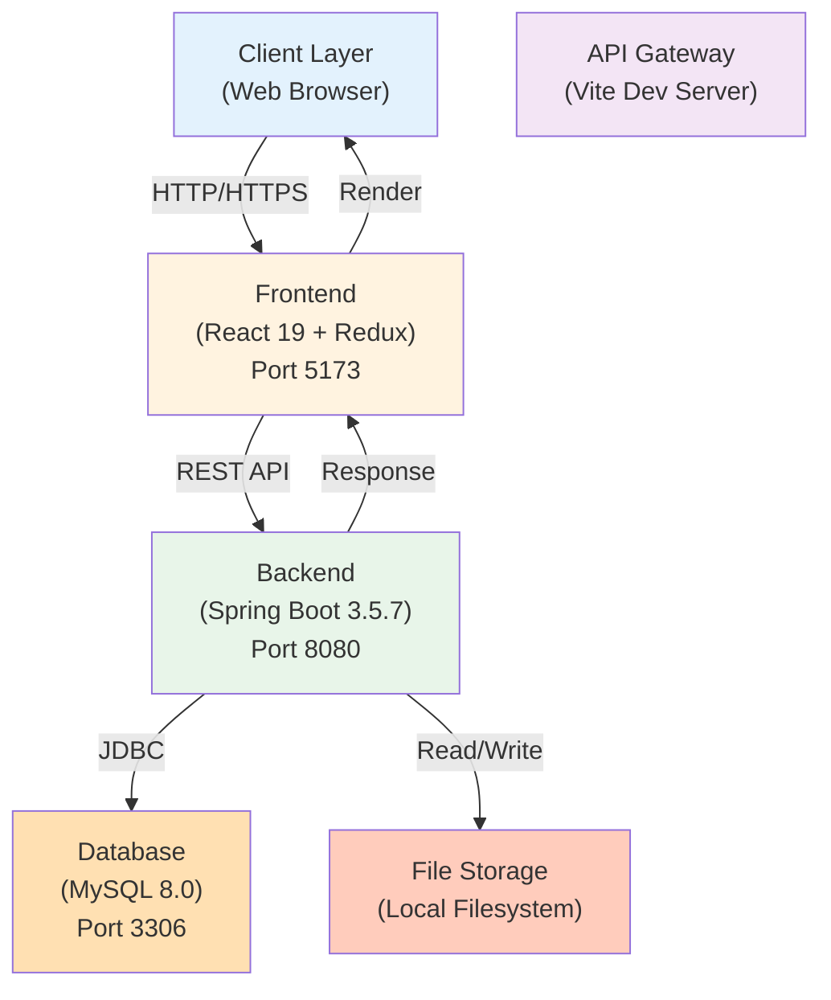

### Backend Layered Architecture

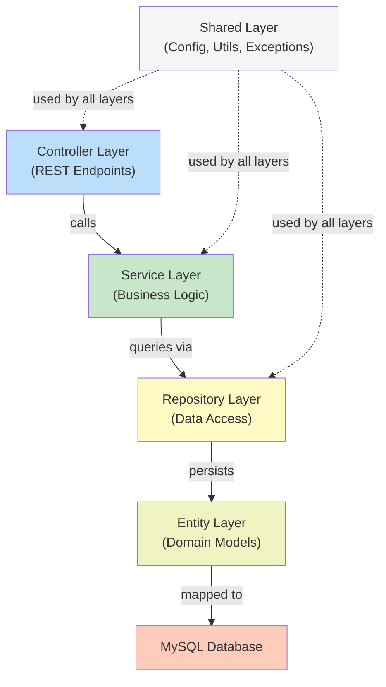

### Frontend Component Architecture

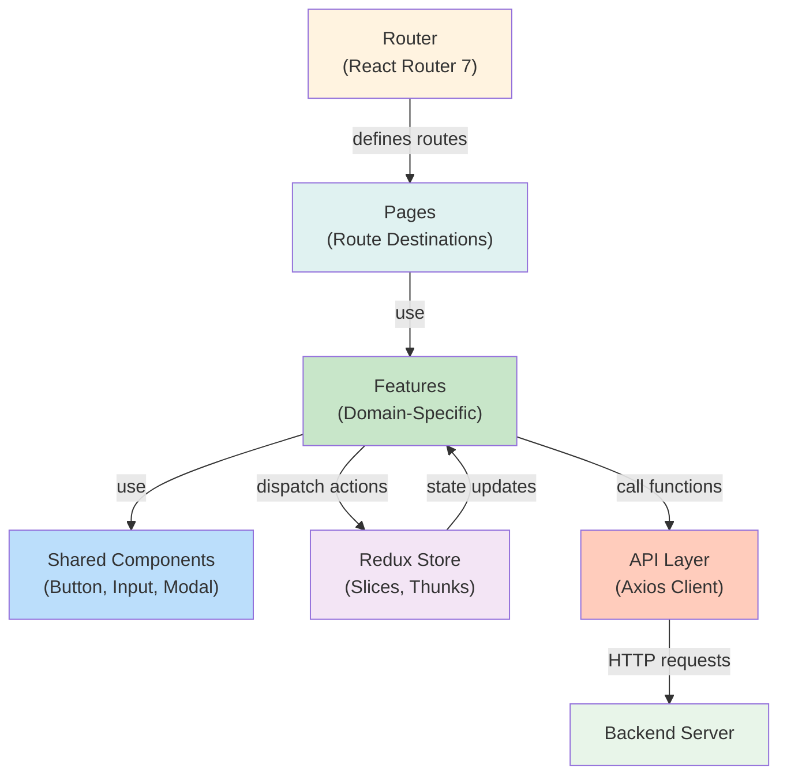

### Module Dependency Graph

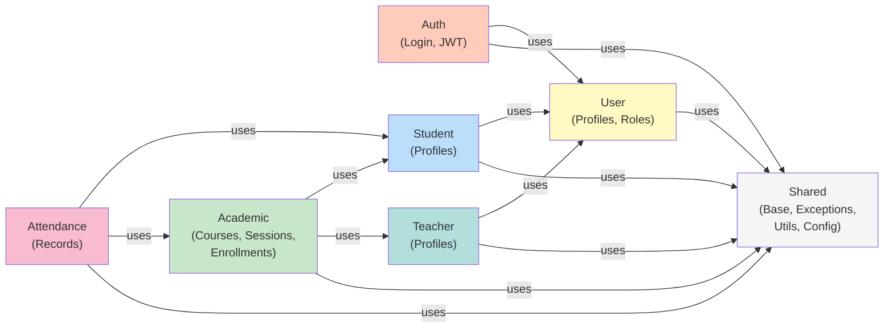

---

## Data Flow Diagrams

### 1. User Login Flow

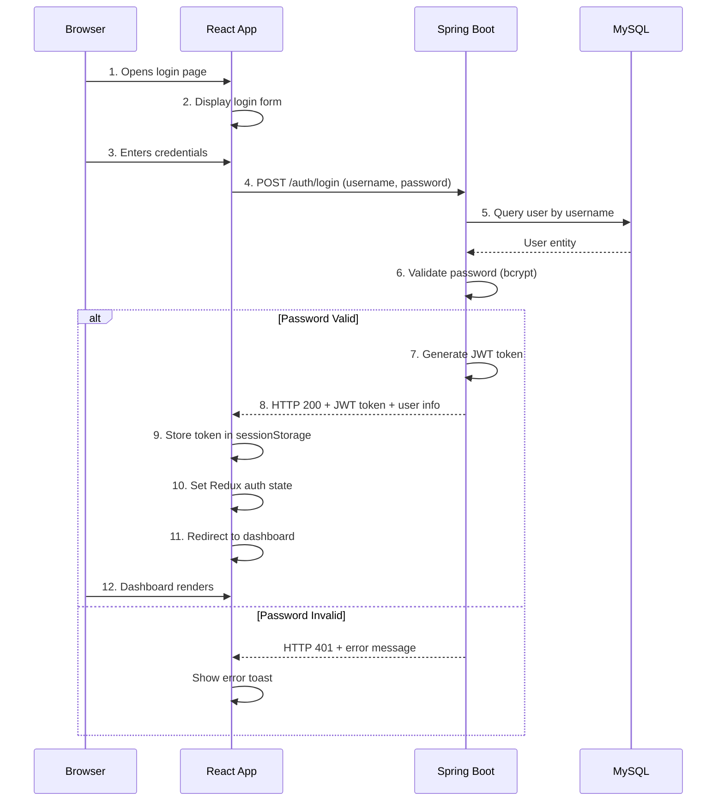

### 2. Course Creation & Enrollment Flow

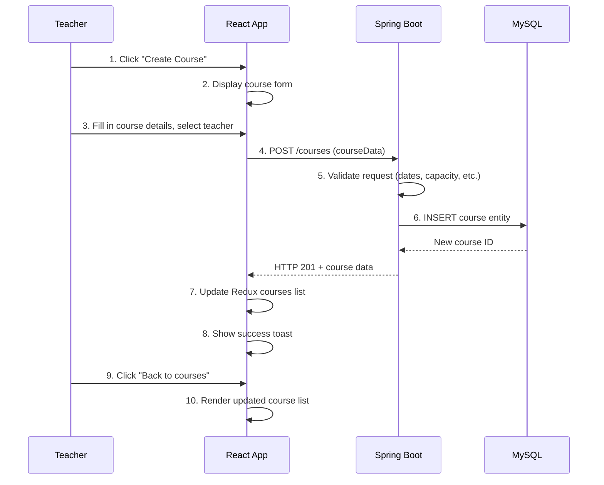

### 3. Student Enrollment with Eligibility Check

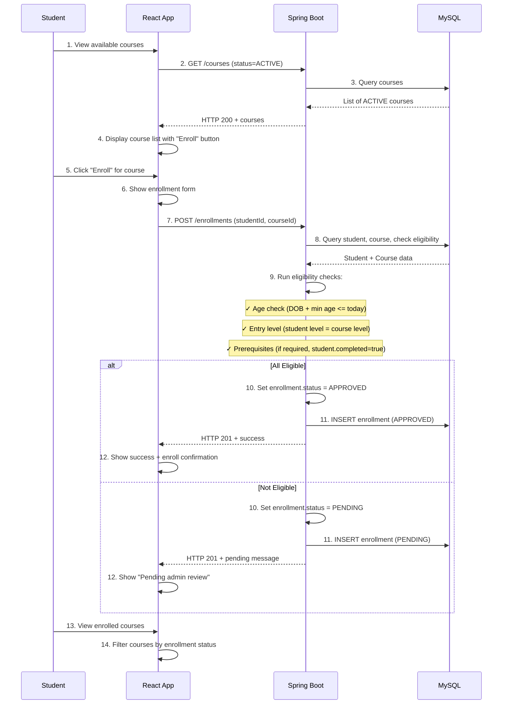

### 4. Attendance Marking Flow

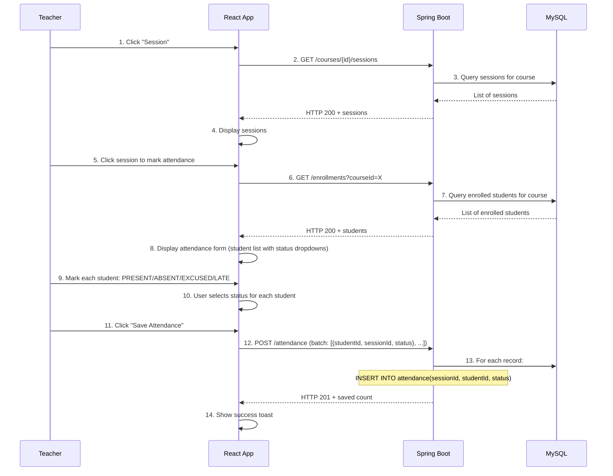

### 5. Session Material Upload Flow

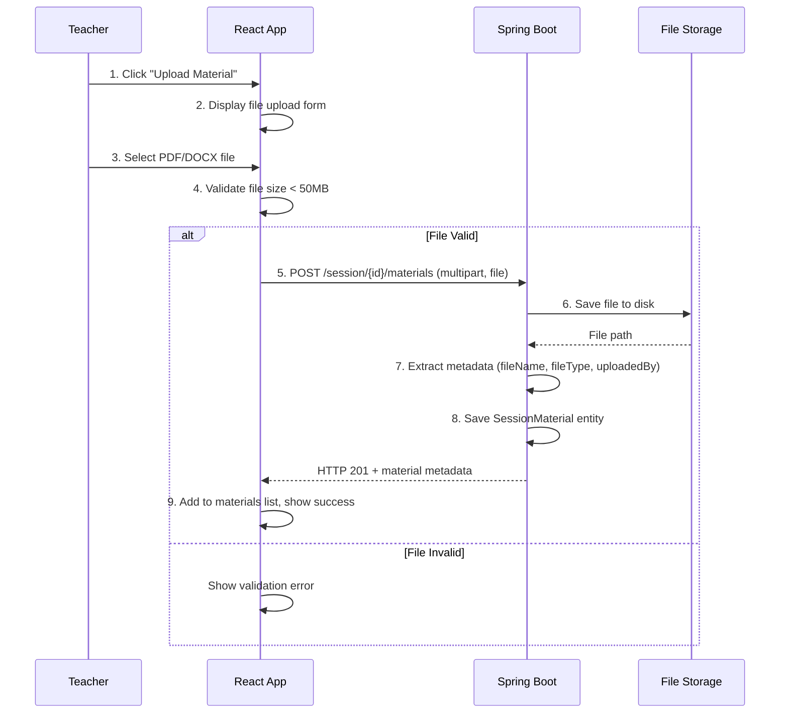

---

## Entity Relationship Model

### Complete ER Diagram with All Fields

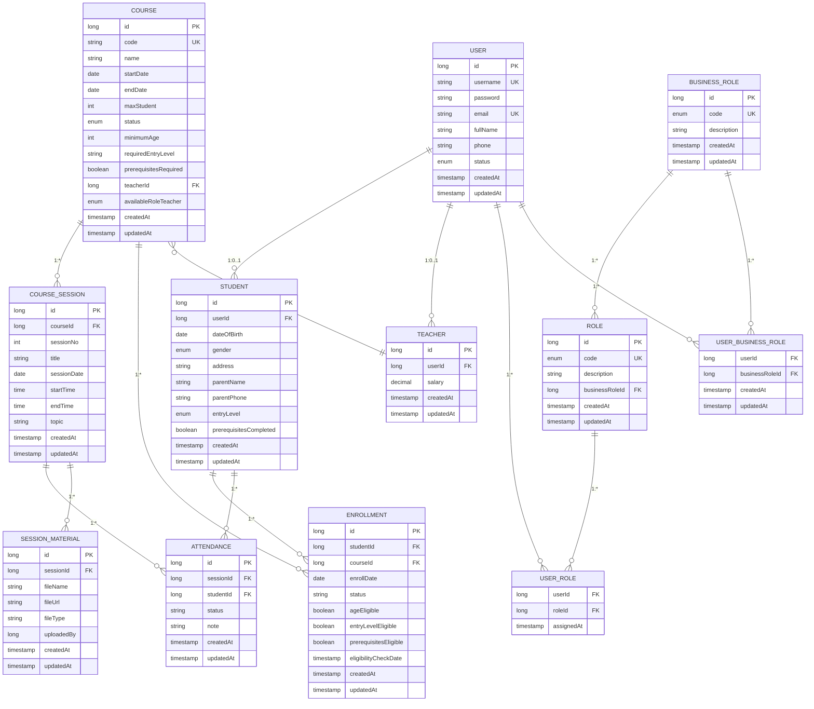

### Key Relationships

#### One-to-One Relationships

| From | To | Constraint | Note |
|------|----|-----------:|------|
| User | Student | unique foreign key | Each user can be at most one student |
| User | Teacher | unique foreign key | Each user can be at most one teacher |

#### One-to-Many Relationships

| From | To | Cardinality | Note |
|------|----|-----------:|------|
| Course | Session | 1:N | A course has many sessions |
| Course | Enrollment | 1:N | A course has many enrollments |
| Student | Enrollment | 1:N | A student has many enrollments |
| Student | Attendance | 1:N | A student has many attendance records |
| Session | Attendance | 1:N | A session has many attendance records |
| Session | Material | 1:N | A session has many materials |
| Teacher | Course | 1:N | A teacher teaches many courses |
| User | Role | 1:N | A user has many system roles |
| User | BusinessRole | 1:N | A user can have multiple business roles (history) |
| BusinessRole | Role | 1:N | A business role contains many system roles |

#### Many-to-Many Relationships (via Junction Tables)

| Left | Junction | Right | Purpose |
|------|----------|-------|---------|
| User | UserRole | Role | Assign granular permissions to users |
| User | UserBusinessRole | BusinessRole | Assign organizational roles |

---

## API Contract Examples

### Authentication API

#### POST /auth/login
**Request:**
```json
{
  "username": "teacher1",
  "password": "securePassword123"
}
```

**Response (200 OK):**
```json
{
  "success": true,
  "data": {
    "token": "eyJhbGciOiJIUzI1NiIsInR5cCI6IkpXVCJ9...",
    "user": {
      "id": 1,
      "username": "teacher1",
      "email": "teacher1@center.com",
      "fullName": "John Teacher",
      "status": "ACTIVE",
      "roles": ["TEACHER"],
      "businessRole": "TEACHER"
    },
    "expiresIn": 3600000
  }
}
```

**Response (401 Unauthorized):**
```json
{
  "success": false,
  "error": {
    "code": "INVALID_CREDENTIALS",
    "message": "Username or password is incorrect"
  }
}
```

---

### Course API

#### POST /courses
**Request:**
```json
{
  "code": "ENG101",
  "name": "English for Beginners",
  "startDate": "2026-07-01",
  "endDate": "2026-08-31",
  "maxStudent": 20,
  "status": "PLANNING",
  "minimumAge": 18,
  "requiredEntryLevel": "BEGINNER",
  "prerequisitesRequired": false,
  "teacherId": 1,
  "availableRoleTeacher": "TEACHER"
}
```

**Response (201 Created):**
```json
{
  "success": true,
  "data": {
    "id": 1,
    "code": "ENG101",
    "name": "English for Beginners",
    "startDate": "2026-07-01",
    "endDate": "2026-08-31",
    "maxStudent": 20,
    "status": "PLANNING",
    "minimumAge": 18,
    "requiredEntryLevel": "BEGINNER",
    "prerequisitesRequired": false,
    "teacher": {
      "id": 1,
      "userId": 5,
      "salary": "5000.00"
    },
    "createdAt": "2026-06-12T10:30:00Z",
    "updatedAt": "2026-06-12T10:30:00Z"
  }
}
```

---

#### GET /courses
**Query Parameters:**
```
GET /courses?status=ACTIVE&page=0&size=10&sort=startDate,desc
```

**Response (200 OK):**
```json
{
  "success": true,
  "data": {
    "content": [
      {
        "id": 1,
        "code": "ENG102",
        "name": "English for Intermediate",
        "startDate": "2026-06-15",
        "status": "ACTIVE",
        "maxStudent": 25,
        "enrolledCount": 18,
        "teacher": {
          "id": 1,
          "userId": 5,
          "user": {
            "fullName": "John Teacher"
          }
        }
      }
    ],
    "totalElements": 5,
    "totalPages": 1,
    "currentPage": 0
  }
}
```

---

### Enrollment API

#### POST /enrollments
**Request:**
```json
{
  "studentId": 10,
  "courseId": 1
}
```

**Response (201 Created):**
```json
{
  "success": true,
  "data": {
    "id": 1,
    "student": {
      "id": 10,
      "userId": 20,
      "entryLevel": "BEGINNER",
      "dateOfBirth": "2000-01-15",
      "prerequisitesCompleted": false
    },
    "course": {
      "id": 1,
      "code": "ENG101",
      "name": "English for Beginners",
      "minimumAge": 18,
      "requiredEntryLevel": "BEGINNER",
      "prerequisitesRequired": false
    },
    "enrollDate": "2026-06-12",
    "status": "APPROVED",
    "ageEligible": true,
    "entryLevelEligible": true,
    "prerequisitesEligible": true,
    "eligibilityCheckDate": "2026-06-12T10:35:00Z"
  }
}
```

**Response (400 Bad Request - Eligibility Failed):**
```json
{
  "success": false,
  "error": {
    "code": "ENROLLMENT_ELIGIBILITY_FAILED",
    "message": "Student does not meet course requirements",
    "details": {
      "ageEligible": true,
      "entryLevelEligible": false,
      "prerequisitesEligible": false
    }
  }
}
```

---

### Attendance API

#### POST /attendance
**Request (Batch):**
```json
{
  "sessionId": 5,
  "records": [
    {
      "studentId": 10,
      "status": "PRESENT"
    },
    {
      "studentId": 11,
      "status": "ABSENT",
      "note": "Sick leave"
    },
    {
      "studentId": 12,
      "status": "EXCUSED",
      "note": "Doctor appointment"
    }
  ]
}
```

**Response (201 Created):**
```json
{
  "success": true,
  "data": {
    "sessionId": 5,
    "recordsCreated": 3,
    "records": [
      {
        "id": 1,
        "studentId": 10,
        "sessionId": 5,
        "status": "PRESENT",
        "note": null,
        "createdAt": "2026-06-12T15:00:00Z"
      },
      {
        "id": 2,
        "studentId": 11,
        "sessionId": 5,
        "status": "ABSENT",
        "note": "Sick leave",
        "createdAt": "2026-06-12T15:00:00Z"
      },
      {
        "id": 3,
        "studentId": 12,
        "sessionId": 5,
        "status": "EXCUSED",
        "note": "Doctor appointment",
        "createdAt": "2026-06-12T15:00:00Z"
      }
    ]
  }
}
```

---

## Security & Authentication Flow

### JWT Token Structure

```
Header.Payload.Signature

Example Token:
eyJhbGciOiJIUzI1NiIsInR5cCI6IkpXVCJ9.
eyJzdWIiOiIxMjM0NTY3ODkwIiwibmFtZSI6IkpvaG4gRG9lIiwiaWF0IjoxNTE2MjM5MDIyfQ.
SflKxwRJSMeKKF2QT4fwpMeJf36POk6yJV_adQssw5c
```

**Decoded Header:**
```json
{
  "alg": "HS256",
  "typ": "JWT"
}
```

**Decoded Payload:**
```json
{
  "userId": 1,
  "username": "teacher1",
  "email": "teacher1@center.com",
  "roles": ["TEACHER"],
  "businessRole": "TEACHER",
  "iat": 1686484800,
  "exp": 1686488400
}
```

**Token Generation (Backend):**
```java
@Service
public class JwtTokenProvider {
  public String generateToken(User user) {
    long expirationTime = System.currentTimeMillis() + JWT_EXPIRATION_MS;
    return Jwts.builder()
        .setSubject(user.getUsername())
        .claim("userId", user.getId())
        .claim("email", user.getEmail())
        .claim("roles", user.getRoles())
        .setIssuedAt(new Date())
        .setExpiration(new Date(expirationTime))
        .signWith(SignatureAlgorithm.HS256, JWT_SECRET)
        .compact();
  }
}
```

---

### Authentication & Authorization Flow

#### Request with JWT Token

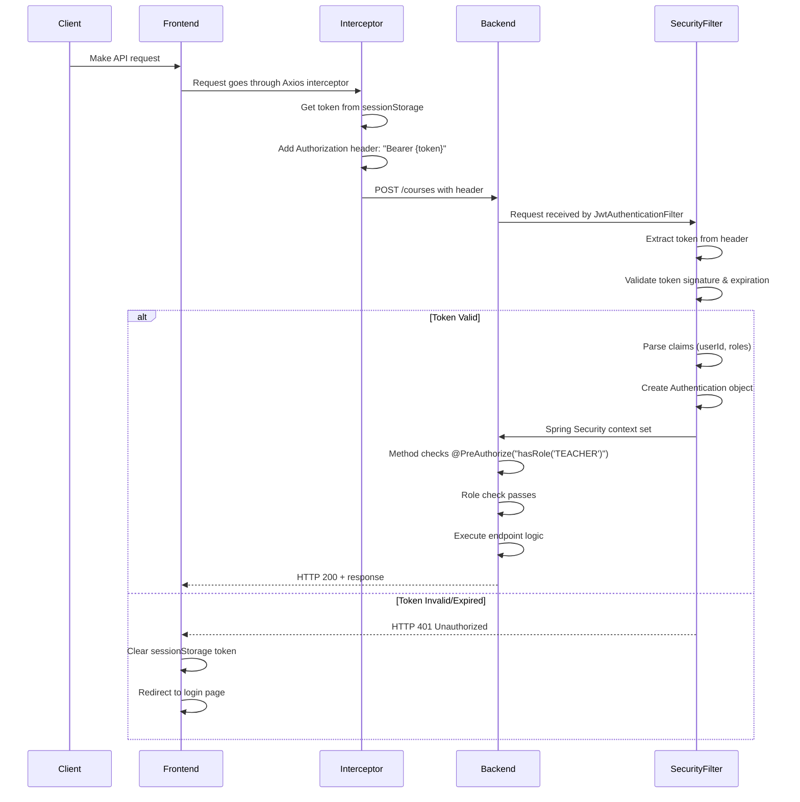

---

### Role-Based Access Control (RBAC)

#### Authorization Annotation Examples

```java
// Admin only
@PreAuthorize("hasRole('ADMIN')")
@PostMapping("/users")
public ResponseEntity<UserResponse> createUser(@Valid @RequestBody CreateUserRequest req) { }

// Teacher or Admin
@PreAuthorize("hasAnyRole('TEACHER', 'ADMIN')")
@PostMapping("/courses")
public ResponseEntity<CourseResponse> createCourse(@Valid @RequestBody CreateCourseRequest req) { }

// Student only
@PreAuthorize("hasRole('STUDENT')")
@PostMapping("/enrollments")
public ResponseEntity<EnrollmentResponse> enrollCourse(@Valid @RequestBody CreateEnrollmentRequest req) { }

// Any authenticated user
@PreAuthorize("isAuthenticated()")
@GetMapping("/users/{id}")
public ResponseEntity<UserResponse> getUserDetail(@PathVariable Long id) { }
```

#### Role Hierarchy

```
ADMIN
  └─ Can do everything (super-user)

TEACHER
  ├─ Create/edit own courses
  ├─ Mark attendance
  ├─ Upload materials
  └─ View student progress

STUDENT
  ├─ Enroll in courses
  ├─ View own attendance
  ├─ Access course materials
  └─ View own grades/progress

STAFF (future)
  ├─ View reports
  ├─ Audit logs
  └─ No data modification
```

---

### Security Best Practices Implemented

1. **Password Hashing**
   - Passwords hashed using bcrypt via Spring Security
   - Never transmitted in plain text
   - Salt generated per password

2. **JWT Signing**
   - HS256 algorithm with minimum 32-character secret
   - Token expiration: 1 hour (configurable)
   - Secret stored in environment variables

3. **Input Validation**
   - @Valid annotations on all request DTOs
   - Custom validators for complex rules
   - Validation at API boundary only

4. **SQL Injection Prevention**
   - JPA parameterized queries only
   - No raw SQL string concatenation

5. **XSS Prevention**
   - React automatic HTML escaping
   - User-generated content treated as text

6. **CORS Configuration**
   - Configured in Spring Security
   - Allows frontend origin only

7. **Secrets Management**
   - No hardcoded secrets
   - Environment variables for all sensitive config

---

**End of Architecture & Data Flow Document**
