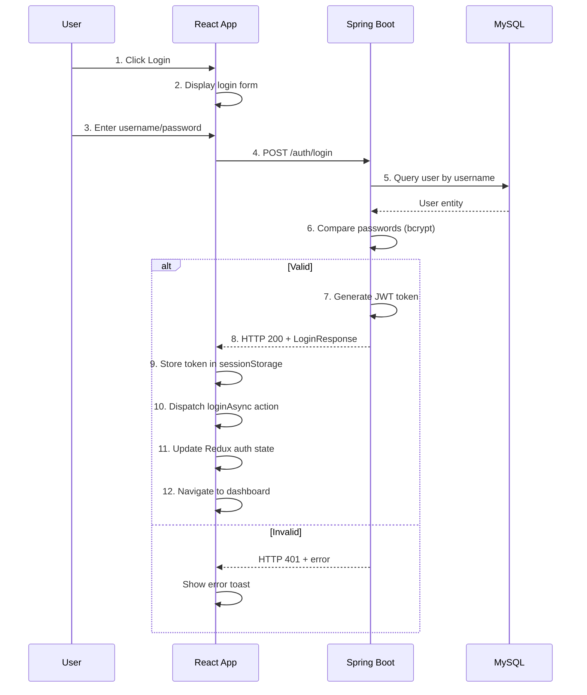

# Authentication & Session Management Feature

**Feature ID:** FEAT-001  
**Module:** Auth  
**Status:** ✅ Complete (MVP)  
**Last Updated:** June 12, 2026

---

## Table of Contents

1. [Feature Overview](#feature-overview)
2. [User Stories](#user-stories)
3. [Technical Architecture](#technical-architecture)
4. [Backend Implementation](#backend-implementation)
5. [Frontend Implementation](#frontend-implementation)
6. [API Contracts](#api-contracts)
7. [Data Models](#data-models)
8. [Workflows](#workflows)
9. [Validation & Error Handling](#validation--error-handling)
10. [Testing](#testing)

---

## Feature Overview

### Purpose
Provide secure user authentication using JWT tokens and maintain user session state across the application.

### Key Capabilities
- User login with username/password validation
- User registration (signup)
- JWT token generation with expiration
- Session persistence across page reloads
- Token validation on protected endpoints
- Logout functionality
- Role-based access control integration

### Scope (Phase 1)
- ✅ Login with credentials
- ✅ Signup (new user registration)
- ✅ JWT token generation & validation
- ✅ Session storage in sessionStorage
- ✅ Role & permission initialization
- ❌ Password reset (Phase 2)
- ❌ Email verification (Phase 2)
- ❌ Refresh token rotation (Phase 2)
- ❌ Multi-factor authentication (Phase 3)

### Success Criteria
- User can login with valid credentials
- User cannot access protected endpoints without valid token
- Session persists across page refresh
- Logout clears session and redirects to login
- User roles are correctly initialized
- Invalid credentials return 401 with clear message
- Token expiration prompts re-login

---

## User Stories

### US-1: User Login
**As a** Teacher or Admin  
**I want to** login with my username and password  
**So that** I can access the system

**Acceptance Criteria:**
- Valid credentials return JWT token
- Token stored in sessionStorage
- User redirected to dashboard
- Invalid credentials show error message
- Login form shows loading state during submission

**Implementation:** [Backend](#backend-implementation), [Frontend](#frontend-implementation)

---

### US-2: User Signup
**As a** New user  
**I want to** create an account with email and password  
**So that** I can use the system

**Acceptance Criteria:**
- Signup form validates email format and password strength
- Duplicate email shows error
- Duplicate username shows error
- New user created with ACTIVE status
- User automatically logged in after signup
- Default role (STUDENT) assigned

**Implementation:** [Backend](#backend-implementation), [Frontend](#frontend-implementation)

---

### US-3: Session Persistence
**As a** Logged-in user  
**I want to** stay logged in after refreshing the page  
**So that** I don't lose my session

**Acceptance Criteria:**
- JWT token persists in sessionStorage
- Redux auth state restored from token
- User doesn't need to re-login on page refresh
- Token expiration properly handled on reload

**Implementation:** [Frontend](#frontend-implementation)

---

### US-4: Logout
**As a** Logged-in user  
**I want to** logout  
**So that** my account is secured

**Acceptance Criteria:**
- Logout button clears token from sessionStorage
- Redux auth state cleared
- User redirected to login page
- Protected pages inaccessible after logout

**Implementation:** [Frontend](#frontend-implementation)

---

### US-5: Protected Routes
**As a** An unauthenticated user  
**I want to** not be able to access protected pages  
**So that** my data is secure

**Acceptance Criteria:**
- Protected routes redirect to login if token missing
- Protected routes redirect to login if token expired
- Public routes (login, signup) accessible without token

**Implementation:** [Frontend](#frontend-implementation)

---

## Technical Architecture

### Component Hierarchy (Frontend)

```
Router
├── PublicLayout
│   ├── LoginPage
│   └── SignupPage
├── ProtectedLayout
│   ├── DashboardPage
│   ├── CoursesPage
│   ├── AdminPage
│   └── ...
└── 401/403 Pages
```

### Redux State Structure (Frontend)

```typescript
authSlice {
  user: {
    id: number,
    username: string,
    email: string,
    fullName: string,
    roles: string[],
    businessRole: string,
    status: string
  },
  token: string | null,
  isLoading: boolean,
  error: string | null,
  isAuthenticated: boolean,
  expiresIn: number // milliseconds
}
```

### Backend Layers

```
AuthController
├── POST /auth/login
├── POST /auth/signup
├── GET /auth/validate
└── POST /auth/logout

↓ calls ↓

AuthService (interface)
├── authenticateUser(username, password)
├── registerUser(signupRequest)
├── validateToken(token)
└── generateToken(user)

↓ uses ↓

UserRepository
├── findByUsername(username)
├── findByEmail(email)
└── save(user)

+ JwtTokenProvider
├── generateToken(user)
└── validateToken(token)
```

---

## Backend Implementation

### Module Structure
```
backend/modules/auth/
├── controller/
│   └── AuthController.java          (3 endpoints)
├── service/
│   ├── AuthService.java             (interface)
│   └── impl/
│       └── AuthServiceImpl.java
├── dto/
│   ├── LoginRequest.java
│   ├── LoginResponse.java
│   ├── SignupRequest.java
│   └── SignupResponse.java
└── mapper/
    └── AuthMapper.java
```

### Controller Endpoints to Implement
| Method | Endpoint | Purpose |
|--------|----------|---------|
| POST | `/auth/login` | Authenticate user, return JWT token |
| POST | `/auth/signup` | Register new user |
| GET | `/auth/validate` | Validate current token |

### Service Layer Requirements
| Method | Purpose |
|--------|---------|
| `authenticateUser(username, password)` | Validate credentials, generate JWT |
| `registerUser(request)` | Create new user, assign role |
| `validateToken(token)` | Check token signature & expiration |
| `generateToken(user)` | Create JWT with user claims |

### Request/Response DTO Structure

**LoginRequest:**
- `username` (required, string)
- `password` (required, string)

**SignupRequest:**
- `username` (required, 3-50 chars)
- `email` (required, valid email format)
- `password` (required, min 6 chars)
- `fullName` (required, string)

**LoginResponse:**
- `id` (number)
- `username` (string)
- `email` (string)
- `fullName` (string)
- `token` (JWT string)
- `roles` (string array)
- `businessRole` (string)
- `expiresIn` (milliseconds)

### Password Hashing
- Use Spring Security's `PasswordEncoder` (bcrypt)
- Salt generated automatically by bcrypt
- Never store plaintext passwords

### Token Management
- **Algorithm:** HS256 (HMAC with SHA-256)
- **Secret:** JWT_SECRET environment variable (minimum 32 characters)
- **Expiration:** JWT_EXPIRATION_MS environment variable (default 3600000 = 1 hour)
- **Claims to include:** userId, username, email, roles, businessRole

### Error Scenarios

| Scenario | HTTP Status | Error Code |
|----------|------------|-----------|
| Invalid credentials | 401 | INVALID_CREDENTIALS |
| Username already exists | 409 | USERNAME_EXISTS |
| Email already exists | 409 | EMAIL_EXISTS |
| Token expired | 401 | TOKEN_EXPIRED |
| Token invalid/malformed | 401 | INVALID_TOKEN |
| User account inactive | 403 | USER_INACTIVE |
| User account suspended | 403 | USER_SUSPENDED |

---

## Frontend Implementation

### Feature Folder Structure
```
frontend/src/features/auth/
├── authApi.ts               (API calls to /auth endpoints)
├── authSlice.ts             (Redux slice for auth state)
├── authThunks.ts            (Redux thunks: loginAsync, signupAsync)
├── types.ts                 (TypeScript interfaces)
├── hooks/
│   ├── useAuthSession.ts    (Hook to get auth state)
│   └── useAuthIdentity.ts   (Hook to get current user)
├── pages/
│   ├── LoginPage.tsx        (Login page route)
│   └── SignupPage.tsx       (Signup page route)
├── components/
│   ├── LoginForm.tsx        (Login form with validation)
│   ├── SignupForm.tsx       (Signup form with validation)
│   ├── ProtectedRoute.tsx   (Wrapper to protect routes)
│   └── AuthGuard.tsx        (Guard to prevent unauth access)
└── services/
    └── sessionManager.ts    (sessionStorage token management)
```

### Redux State Structure
```typescript
authSlice {
  user: { id, username, email, fullName, roles, businessRole } | null
  token: string | null
  isLoading: boolean
  error: string | null
  isAuthenticated: boolean
  expiresIn: number  // milliseconds
}
```

### Redux Thunks to Implement
| Thunk | Purpose |
|-------|---------|
| `loginAsync(credentials)` | POST /auth/login, store token, update state |
| `signupAsync(data)` | POST /auth/signup, auto-login, update state |

### Redux Reducers to Implement
| Reducer | Purpose |
|---------|---------|
| `logout()` | Clear token from state and sessionStorage |
| `restoreSession(payload)` | Restore auth from sessionStorage on app load |

### Pages to Implement
- **LoginPage.tsx** - Display login form, handle submission, redirect on success
- **SignupPage.tsx** - Display signup form, handle submission, auto-login

### Components to Implement
- **LoginForm.tsx** - Form with username/password fields, validation, submit
- **SignupForm.tsx** - Form with username/email/password/fullName, validation
- **ProtectedRoute.tsx** - Wrapper component to guard protected routes
- **AuthGuard.tsx** - Check token validity on app initialization

### API Layer Requirements (authApi.ts)
- `loginApi(LoginRequest)` - POST /auth/login
- `signupApi(SignupRequest)` - POST /auth/signup  
- `validateTokenApi()` - GET /auth/validate

### Session Storage Management
| Operation | Purpose |
|-----------|---------|
| `saveToken(token, expiresIn)` | Store token in sessionStorage |
| `getToken()` | Retrieve token from sessionStorage |
| `isTokenExpired()` | Check if token has expired |
| `clearToken()` | Remove token on logout |

### Form Validation (Use Zod)
**LoginForm fields:**
- username: min 3 chars, required
- password: min 6 chars, required

**SignupForm fields:**
- username: 3-50 chars, required
- email: valid format, required
- password: min 6 chars, uppercase, number, required
- fullName: required

---

## API Contracts

### POST /auth/login

**Request:**
```json
{
  "username": "teacher1",
  "password": "SecurePass123"
}
```

**Response (200 OK):**
```json
{
  "success": true,
  "data": {
    "id": 1,
    "username": "teacher1",
    "email": "teacher1@center.com",
    "fullName": "John Teacher",
    "token": "eyJhbGciOiJIUzI1NiIsInR5cCI6IkpXVCJ9...",
    "roles": ["TEACHER"],
    "businessRole": "TEACHER",
    "expiresIn": 3600000
  }
}
```

**Response (401 Unauthorized):**
```json
{
  "success": false,
  "error": {
    "code": "INVALID_CREDENTIALS",
    "message": "Username or password is incorrect"
  }
}
```

---

### POST /auth/signup

**Request:**
```json
{
  "username": "newstudent",
  "email": "student@email.com",
  "password": "SecurePass123",
  "fullName": "Jane Student"
}
```

**Response (201 Created):**
```json
{
  "success": true,
  "data": {
    "id": 10,
    "username": "newstudent",
    "email": "student@email.com",
    "fullName": "Jane Student",
    "token": "eyJhbGciOiJIUzI1NiIsInR5cCI6IkpXVCJ9...",
    "roles": ["STUDENT"],
    "businessRole": "STUDENT",
    "expiresIn": 3600000
  }
}
```

---

### GET /auth/validate

**Purpose:** Check if current token is valid (used by frontend)

**Request Headers:**
```
Authorization: Bearer {token}
```

**Response (200 OK):**
```json
{
  "success": true,
  "data": true
}
```

**Response (401 Unauthorized):**
```json
{
  "success": false,
  "error": {
    "code": "INVALID_TOKEN",
    "message": "Token is invalid or expired"
  }
}
```

---

## Data Models

### User Entity (User created during auth)
```
User {
  id: Long (PK)
  username: String (UK) - Immutable
  password: String (hashed)
  email: String (UK)
  fullName: String
  phone: String
  status: UserStatus (ACTIVE, INACTIVE, SUSPENDED)
  createdAt: DateTime (auto)
  updatedAt: DateTime (auto)
}
```

### JWT Payload
```json
{
  "sub": "teacher1",
  "userId": 1,
  "username": "teacher1",
  "email": "teacher1@center.com",
  "roles": ["TEACHER"],
  "businessRole": "TEACHER",
  "iat": 1686484800,
  "exp": 1686488400
}
```

---

## Workflows

### Login Workflow



### Session Restoration Workflow

```
App Startup
  ↓
Check sessionStorage for token
  ↓
Token exists?
  ├─ Yes → Call /auth/validate
  │  ├─ Valid → Restore Redux auth state → Ready
  │  └─ Invalid → Clear sessionStorage → Redirect login
  └─ No → Show login page
```

### Logout Workflow

```
User clicks Logout
  ↓
Clear sessionStorage token
  ↓
Dispatch logout action
  ↓
Redux auth state cleared
  ↓
Navigate to /login
```

---

## Validation & Error Handling

### Frontend Validation (React Hook Form + Zod)

```typescript
export const loginSchema = z.object({
  username: z
    .string()
    .min(1, 'Username required')
    .min(3, 'Username min 3 characters'),
  password: z
    .string()
    .min(1, 'Password required')
    .min(6, 'Password min 6 characters')
});

export const signupSchema = z.object({
  username: z
    .string()
    .min(3, 'Username min 3 characters')
    .max(50, 'Username max 50 characters'),
  email: z
    .string()
    .email('Valid email required'),
  password: z
    .string()
    .min(6, 'Password min 6 characters')
    .regex(/[A-Z]/, 'Password must contain uppercase')
    .regex(/[0-9]/, 'Password must contain number'),
  fullName: z
    .string()
    .min(1, 'Full name required')
});
```

### Backend Validation
- @NotBlank, @Email, @Size on request DTOs
- Validate password against bcrypt before JWT generation
- Check user status (ACTIVE, INACTIVE, SUSPENDED)

### Error Responses

```typescript
interface ErrorResponse {
  success: false;
  error: {
    code: string; // INVALID_CREDENTIALS, TOKEN_EXPIRED, etc.
    message: string; // User-friendly message
    details?: Record<string, string>; // Field-level validation errors
  };
}
```

---

## Testing

### Backend Unit Tests (Planned)
```
✅ LoginRequest validation
✅ SignupRequest validation
✅ AuthService.authenticateUser success
✅ AuthService.authenticateUser failure (invalid credentials)
✅ AuthService.registerUser success
✅ AuthService.registerUser failure (duplicate email)
✅ JwtTokenProvider.generateToken
✅ JwtTokenProvider.validateToken
```

### Frontend Integration Tests (Planned)
```
✅ LoginPage renders form
✅ LoginForm validates required fields
✅ LoginForm submits valid credentials
✅ LoginForm shows error on invalid credentials
✅ Token stored in sessionStorage after login
✅ Redux auth state updated after login
✅ ProtectedRoute redirects if no token
✅ Session restored on page reload
✅ Logout clears token and redirects
```

### Manual Testing Checklist
- [ ] Valid login succeeds
- [ ] Invalid password shows error
- [ ] Nonexistent username shows error
- [ ] Session persists after refresh
- [ ] Logout removes token and redirects
- [ ] Protected pages show login page when not authenticated
- [ ] Token expiration redirects to login
- [ ] Signup creates new user
- [ ] Duplicate email in signup shows error
- [ ] Duplicate username in signup shows error

---

## Configuration

### Backend (.env)
```
JWT_SECRET=your-secret-key-at-least-32-characters-long
JWT_EXPIRATION_MS=3600000
SERVER_PORT=8080
```

### Frontend (.env)
```
VITE_API_BASE_URL=http://localhost:8080/api
```

---

## Future Enhancements (Phase 2+)

- [ ] Password reset via email
- [ ] Email verification on signup
- [ ] Refresh token rotation
- [ ] Multi-factor authentication (2FA)
- [ ] Social login (Google, Facebook)
- [ ] Session timeout warning
- [ ] Account lockout after failed attempts
- [ ] Login history tracking

---

**End of Auth Feature Documentation**
